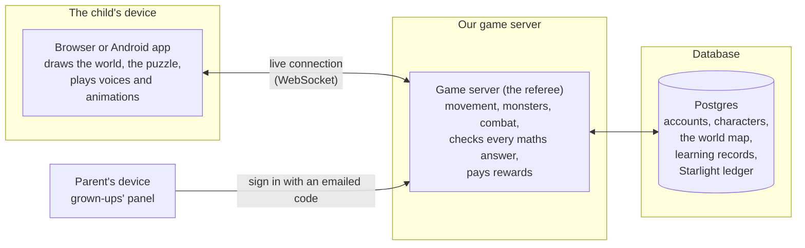
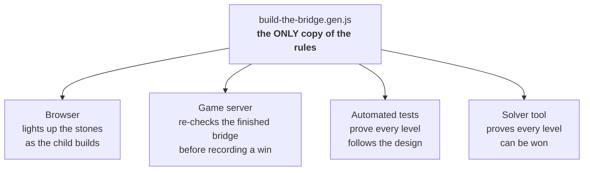
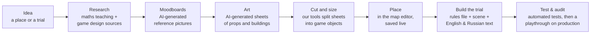

# How Lumia works

This page explains, in plain words, how the pieces of Lumia fit together.
You don't need to know game programming to follow it.

## 1. The three pieces

- **The child's device** shows everything: the painted world, the
  characters, the puzzle. It can *predict* what will happen so the game
  feels instant, but its predictions are only for show.
- **The game server** is the referee. It decides where everyone really is,
  whether a monster was hit, whether a maths answer is right, and what
  reward it earns. The two are connected by a WebSocket, a phone line that
  stays open so both sides can talk at any moment.
- **The database** remembers everything: accounts, characters, what each
  child has learned, and even **the world map itself**. Our map editor
  saves each change straight into the database, so the world can grow
  without a new release of the game.

### Why the server is the referee

Children (and their older siblings) are curious. If the browser decided
"you got it right, here are 100 gold", anyone could open the browser's
developer tools and give themselves the gold. In Lumia the browser can only
*ask*. The server checks the answer itself and records the result. The same
rule protects the reward economy, trading between children, and the paid
membership.

If the server is unreachable, the game still opens in an **Explore** mode:
the world, the bag and the practice activities work, but nothing that pays
a reward does.

## 2. One rulebook per trial

The most important design choice in our maths trials:

**Before** this design, a trial's rules could be written twice: once in the
browser (to show the child) and once on the server (to grade them). Two
copies drift apart. Then a child sees "correct" and the server records
"wrong", which is the worst thing a learning game can do to a 7-year-old.

**After**: one file holds the maths and nothing else (no drawing, no
buttons). The browser, the server, the tests and a solver tool all load that
same file. What the child sees and what the server records **cannot**
disagree. See [`samples/build-the-bridge/`](samples/build-the-bridge/).

## 3. How a new place or trial gets made

Lumia's world is hand-painted. For a small team that is only affordable
because of our content pipeline:

Each stage is a column on a work board, and each column has a written
procedure that both people and AI coding assistants follow. A person approves
the art before it goes into the world. A trial ships only after its tests
pass, and then it is played on the live game.

## 4. Technology, briefly

| Part | Technology | Why |
|---|---|---|
| Game client | Plain JavaScript, HTML and canvas, with no build step | Loads fast, runs on cheap school laptops and phones, and every file is exactly what ships |
| Game server | [Colyseus](https://colyseus.io/) (Node.js, TypeScript) | Open-source framework built for real-time multiplayer rooms |
| Database | Postgres via Prisma | One reliable database for accounts, the map and the ledger |
| Hosting | Railway | One service serves the game files and runs the server |
| Payments | Polar | Handles the parent's membership purchase |
| Email | Resend | Waitlist welcome and parent sign-in codes |
| Android | Trusted Web Activity | The same web game, installed as an app |
