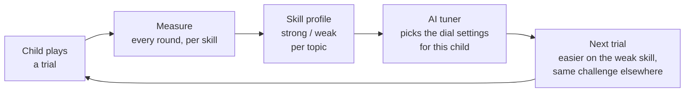

# Why Lumia wins: a learning dataset no quiz can collect

**A quiz learns one thing about a child: right or wrong. Lumia watches the
child *use* maths inside dozens of different game mechanics, skill by skill,
round by round. That builds a far richer picture of what each child can and
cannot do. That picture is the fuel for Lumia's personalisation loop, which is
designed to tune the next trial to the child's weak skill and keep
everything else just as challenging.**

---

## 1. What a quiz sees vs. what Lumia sees

| | Traditional quiz platform | Lumia |
|---|---|---|
| What the child does | Types or taps an answer | Weighs stones on a balance, lays a bridge over a river, measures a trail with a rope, hops the ice floe that continues a pattern |
| What gets recorded | Correct / incorrect per question | Every round of every trial: correct or not, how long it took, whether the child gave up, which grade and which maths topic |
| How skills are separated | One score per worksheet | Each trial is tagged against a map of **192 maths topics for Grades 1–4**, so the same skill is measured through many different mechanics |
| What it can tell you | "Scored 7/10 on measurement" | "Measures confidently with a ruler but struggles to compare lengths with a rope. Counts well in patterns but not when a pattern has to fill a gap" |

The key idea is that **the same skill is measured through many mechanics.**
Multiplication shows up in a waiter serving equal groups (The Lantern Table),
in a temple floor of numbered slabs (The Crumbling Sanctuary) and in a rope
trail (Tracker). A child who passes one and fails another isn't just "weak at
multiplication". We can see *which kind* of multiplication thinking is
missing. A quiz, which asks every question the same way, can't see that.

## 2. What Lumia records today

Every time a child finishes or leaves a trial, the game server saves one
learning record:

| Field | Meaning |
|---|---|
| trial | which activity, e.g. `hall-of-scales` |
| grade, topic | which part of the curriculum it practised |
| rounds, correct, needed | how many rounds were played, how many were clean, how many were needed to win |
| per-round detail | for each round, right or wrong and the time taken |
| abandoned | whether the child quit partway, often the clearest sign a trial was too hard |

Records are **append-only**: each new result is added as a new line, and old
lines are never rewritten. A child's full learning history is therefore always
available in order, and it accumulates across every place and every trial in
the world.

## 3. The data can't be faked

On most learning websites the child's browser decides "correct!" and reports
it. A curious child (or an older sibling) can fake it, and then the data is
worthless.

In Lumia the browser only **shows** the puzzle. For graded trials the game
server is the **referee**. It issues the question, checks the answer with the
same rules the game displays, and only then writes the learning record. A child can't
award themselves a win by editing the page. Every record in the dataset
reflects what the child actually did.

## 4. The personalisation loop

Lumia is built in two layers:

**A. Hand-built mechanics with difficulty dials.** Our designers build each
mechanic once (the balance, the river crossing, the rope trail). The maths
inside is a separate list of numbers and rules, not code. Our river-crossing
engine already runs a different track for each grade at real rivers in the
world, and only the numbers change between grades. Every mechanic therefore
exposes dials: how big the numbers are, which units are used, how many
pieces there are, how many rounds are needed to win.

**B. AI that turns the dials for each child.** The skill profile from the
learning records tells the tuner where a child is strong and where they
struggle. The tuner sets each dial separately. It eases only the skill that
is weak and keeps the rest of the trial at full challenge, so the child is
never bored and never stuck.

### An example, with trials you can play today

Mia is in Grade 4. In **Ice Ruins** she spots number patterns quickly and
clean, round after round. On the **Tracker** rope trail she keeps quitting
when she has to compare lengths ("twice one rope" vs "one rope and 3 metres
more").

Her next trial is a river crossing, **The Measured Reach**, where she closes
each gap in the river with numbered pieces. The loop keeps its number puzzle
at full Grade 4 difficulty, because she's good at that, and makes the lengths
friendlier: whole metres instead of awkward mixes, and fewer pieces to
combine. She crosses the river. Her measuring gets practice at a level she
can win, and the dials move back up as her records improve.

A quiz platform would have given Mia "more measurement questions", the same
kind she was already failing.

## 5. Why this is a moat

- **It compounds.** Every trial played adds records. More children produce
  better skill profiles, which produce better tuning, which keeps children
  playing, which produces more records.
- **It's hard to copy.** A competitor would need the mechanics (each trial is
  hand-designed, built, tested and painted), the topic map that links them,
  *and* a server that makes the data trustworthy. Quiz platforms have none of
  the three, and they collect only answers.
- **It's what parents are paying for.** "Your child is strong at patterns and
  is now practising comparing lengths" is a sentence a parent understands and
  values far more than a percentage.

---

## Built with

| Part | Technology |
|---|---|
| Game client | JavaScript in the browser, no build step; also an Android app |
| Game server (the referee) | Colyseus on Node.js, TypeScript |
| Learning records and world | Postgres via Prisma |
| Hosting | Railway |
