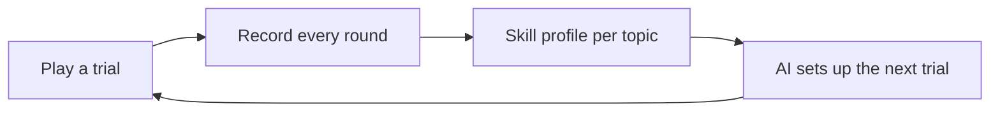

# Personalised learning from play data

A quiz stores one answer per question. Lumia stores how a child does in every
round of every trial, across different mechanics that train the same skill.
That data is built to shape the child's next trial.

## What we record

One record per child per trial:

| Field | Example |
|---|---|
| trial | `tracker` |
| grade, topic | Grade 4, comparing lengths |
| rounds played / clean / needed | 5 / 2 / 4 |
| each round | correct or not, seconds taken |
| quit partway | yes |

Every trial is tagged against 192 maths topics for Grades 1–4.

## Why it beats quiz data

One skill appears in several mechanics. Multiplication is a waiter serving
equal groups in The Lantern Table and a rope copied along a trail in Tracker.
A child who passes one and fails the other shows which kind of thinking is
missing. A quiz asks every question the same way, so it can't see that.

## How the next trial adapts

Designers build each mechanic by hand. Its maths is stored as data, apart from
the code, so one mechanic runs many versions. For each child the AI is
designed to:

- raise or lower difficulty on one skill and leave the rest alone
- change parts of the trial: units, number of pieces, the rule
- swap the trial for a version that is easier in the weak aspect only
- move back up once the records improve

## Example

Mia, Grade 4. Fast and clean on number patterns in Ice Ruins. Quits Tracker
when she has to compare lengths. Her next river crossing, The Measured Reach,
keeps the number puzzle at Grade 4 and switches to whole-metre gaps with fewer
pieces. When her Tracker records improve, the lengths get harder again.

## Why it compounds

Every trial played improves the tuning. Copying it takes both the hand-built
mechanics and the play data on them. Quiz platforms have neither.

## Built with

| Part | Technology |
|---|---|
| Game client | Browser JavaScript, no build step; Android app |
| Game server | Colyseus on Node.js, TypeScript |
| Records and world | Postgres via Prisma |
| Hosting | Railway |
