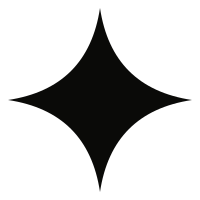

  

<h1 align="center">Lumia</h1>

  <b>A multiplayer adventure world where kids learn maths by playing it.</b> 
  Submission to the <b>Colosseum Crypto World's Fair</b> hackathon (Sep 14 – Oct 12, 2026)

  🌐 <b>Website:</b> <a href="https://lumia.game">lumia.game</a> &nbsp;·&nbsp;
  🎮 <b>Play now:</b> <a href="https://game-production-d440.up.railway.app/game.html">game-production-d440.up.railway.app/game.html</a>

---

## What Lumia is

Lumia is an isometric (2.5D, "seen from above at an angle") online role-playing
game for primary-school children. Kids explore a hand-painted world, meet
characters, go on quests, fight very easy pastel monsters, and team up with
friends.

The maths is **inside the world, not in front of it**. Instead of a quiz that
pops up between fights, every "trial" is a physical puzzle that *is* the maths:

- **Hall of Scales** — put numbered stones on a balance until both sides weigh
  the same. The beam really tips by the difference, so the child *sees* an
  equation.
- **Build the Bridge** — lay stones over a chasm to make a bridge of exactly the
  area the level asks for, then walk across it.
- **The Lantern Table** — a waiter serves equal groups of lanterns (Grade 2
  multiplication).
- **Ice Ruins** — hop only onto the ice floe that continues the number pattern.

Every trial ships in **English and Russian**, with voiced characters, and
works on laptops, tablets and phones (there is also an Android app).

## Traction

| | |
|---|---|
| **200** | waitlist spots claimed on [lumia.game](https://lumia.game) |
| **70** | interviews with parents and kids |
| **10** | committed buyers, currently testing with us in a closed beta |

## What we built during the hackathon

Lumia existed before the hackathon. The rules ask us to say exactly what is new,
so [**HACKATHON.md**](HACKATHON.md) splits our history at Sep 14, 2026, with
dates and numbers. In short:

- **1,296 commits** in the hackathon window (54% of all commits ever made),
  adding **~238,000 lines of code** and **~162,000 lines of design and research
  docs**.
- **14 new or rebuilt maths trials**, a paid membership for parents, a
  grown-ups' panel, an in-game Starlight currency, a voiced narration system,
  full Russian translation, the lumia.game waitlist, and the Android app.

## How it works (one paragraph)

The game runs in the browser. A game server is the **referee**. The child's
browser shows the world and the puzzle, but the server decides whether an
answer is right and what reward it earns. A child cannot fake a win by editing
the page. Each trial's rules live in **one file** that the browser, the server
and the tests all read, so what the child sees and what the server records can
never disagree. Diagrams and details: [**ARCHITECTURE.md**](ARCHITECTURE.md).

## What's in this repository

| Path | What it is |
|---|---|
| [`README.md`](README.md) | This page |
| [`HACKATHON.md`](HACKATHON.md) | What existed before Sep 14 and what we built during the hackathon |
| [`ARCHITECTURE.md`](ARCHITECTURE.md) | How the game, the server and our content pipeline fit together |
| [`samples/`](samples/) | Real, unedited code from the shipped game, with a guide to each file |
| [`LICENSE`](LICENSE) | All rights reserved; code shown for evaluation only |

**Why only samples?** The full game (a ~234,000-line browser client and a
~50,000-line game server) is closed source. This repository holds hand-picked
files built during the hackathon. They show how we work without publishing the
whole product. The samples are copied byte-for-byte from production.

## Blockchain

Lumia has **no blockchain integration**. We are entering the overall competition.

## Videos and team

The pitch video, the product demo and the team details are attached to our
Colosseum submission form.
